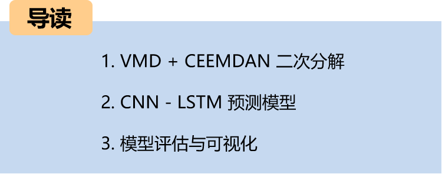
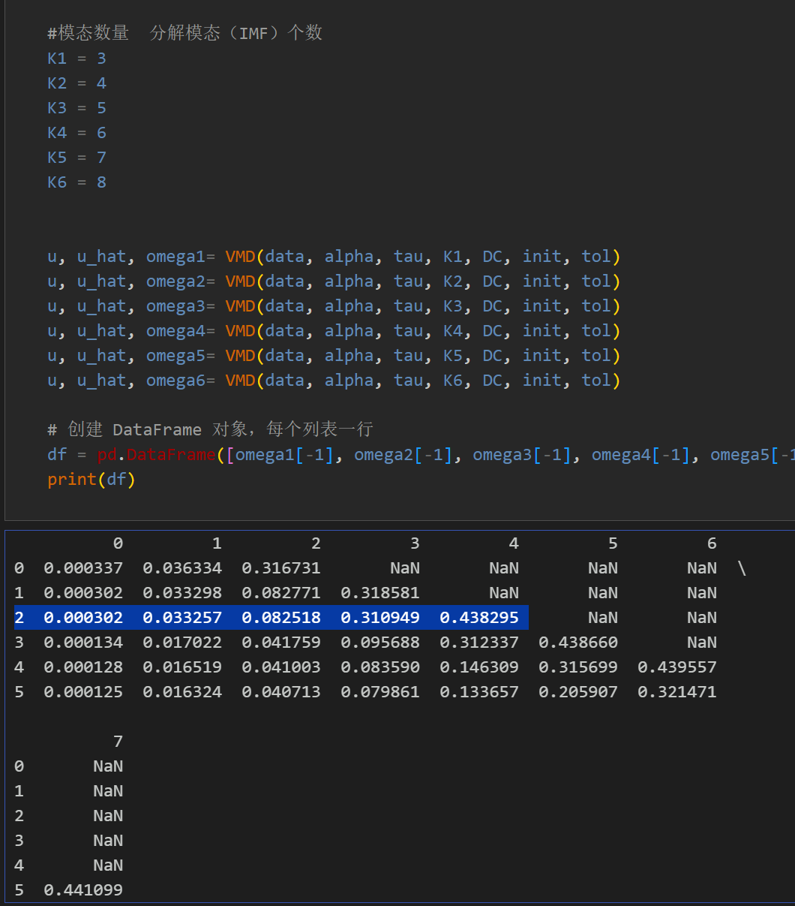
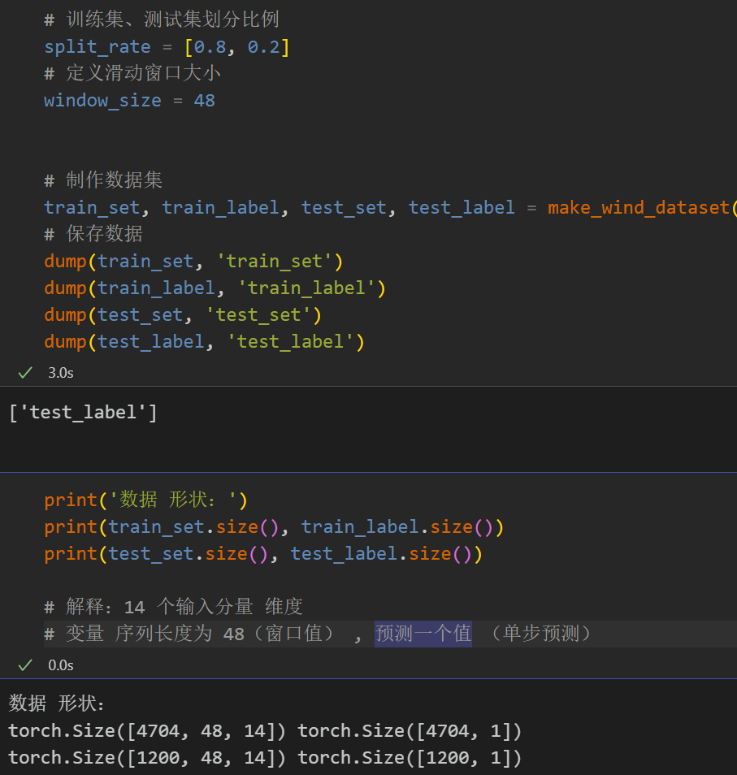
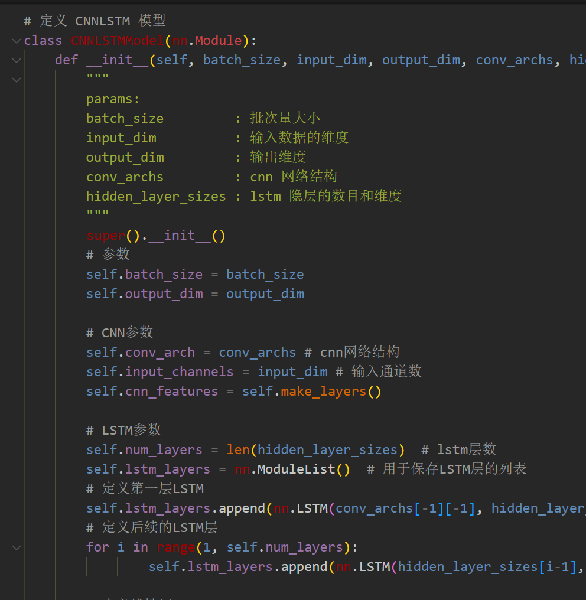
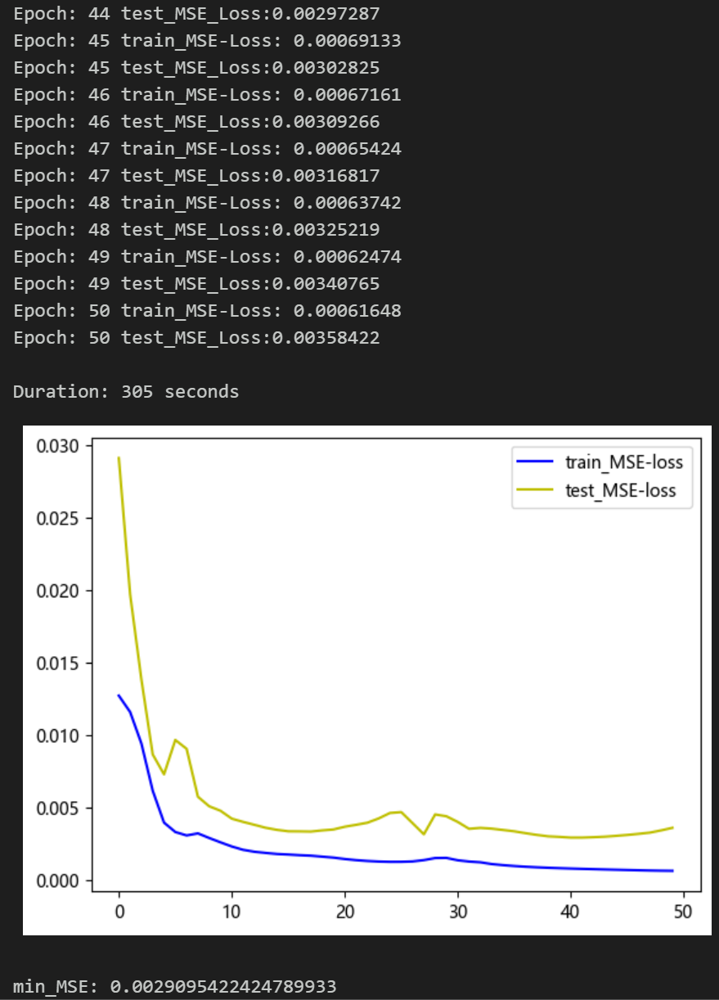
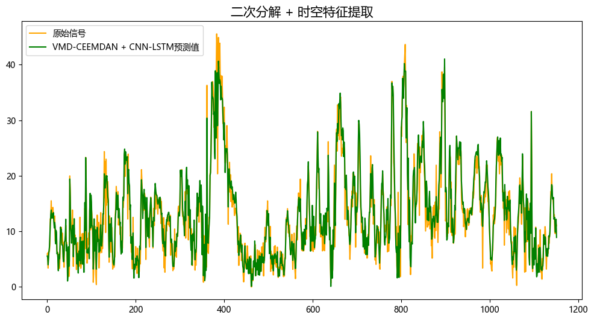
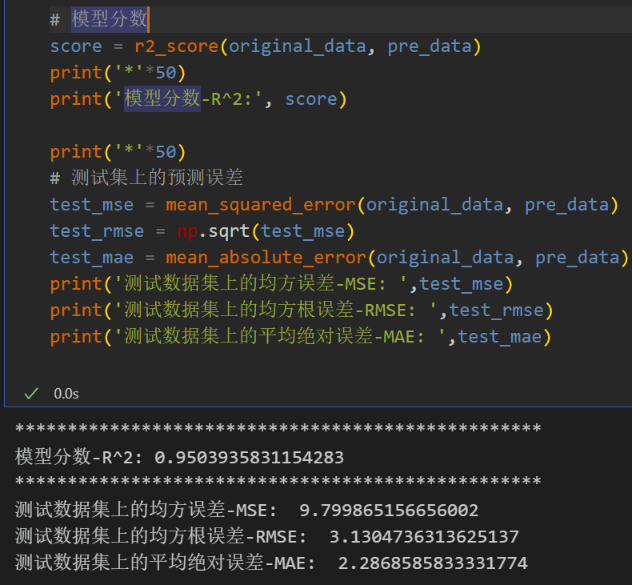

# VMD + CEEMDAN Second Decomposition, CNN-LSTM Prediction Model

Innovation Point: Secondary decomposition + Spatio-Temporal feature extraction including wind speed data, as well as the already generated and prepared wind speed dataset and label set, corresponding codes can be run.
VMD + CEEMDAN secondary decomposition, CNN-LSTM prediction model, with smaller MSE and MAE, the effect is particularly obvious, showing significant improvement!
Includes data preprocessing and secondary decomposition codes, as well as complete CNN-LSTM model prediction code and visualization code.
Innovation Point: Secondary decomposition + Spatio-temporal feature extraction
Preface
This paper introduces a CNN-LSTM prediction model based on VMD+CEEMDAN secondary decomposition, which is introduced based on the wind speed data previously introduced (dataset attached at the end of this article), to enhance the predictive performance of time series data.
1. Secondary decomposition and dataset creation
1.1 Import data
1.2 VMD Decomposition
Step 1: Observe the center frequency under different K values, select the K value; starting from K=4, modes with similar center frequencies appear, indicating overdecomposition. Therefore, the number of modes K is set to 4.
\t  
Step two, decomposition of visualization
\t1.3 Sample Entropy
Sample entropy is a method used to measure the complexity of sequences, by calculating the uncertainty within the sequence to evaluate its complexity. The higher the sample entropy, the greater the complexity of the sequence.
Through the calculation of sample entropy from four components decomposed by VMD, the residual item IMF4 has richer uncontrollable information. To further extract the effective information in IMF4, the CEEMDAN decomposition is applied to the residual item IMF4 of VMD.
\t  
\t1.4 CEEMDAN decomposition
Re-decompose the last residual component extracted from VMD.
1.5 Dataset Preparation
\tFirstly, merge the components of VMD and CEEMDAN decomposition, and divide the training set and test set according to 8:2.
In processing LSTF issues, selecting an appropriate window size (window size) is crucial. Selecting the right window size can help the model better capture patterns and features within time series. To extract longer dependencies for sequence modeling, this paper increases the window size to 48 and employs a CNN-BiLSTM model to fully extract spatiotemporal feature information from the component sequences.
2 Prediction Model Based on Pytorch's CNN-LSTM
2.1 Define the CNN-LSTM prediction model
Note: The input wind speed data shape is [64, 48, 14], batch_size=64, where 48 represents the sequence length (the sliding window values), and dimension 14 represents the dimension of the merged components.
2.2 Set parameters and train the model
50 epochs, MSE is 0.00290, the CNN-LSTM prediction effect is good after VMD+CEEMDAN secondary decomposition. After secondary decomposition, more information can be extracted from the sequence, the CNN-LSTM model can extract the spatiotemporal information of the component features, and the prediction effect is significantly improved, with excellent performance. By appropriately adjusting model parameters, the model prediction performance can be further enhanced.
Note adjustments:
- Modify the number of CNN layers and each layer's dimensions;
- Adjust the hidden layers and dimensions of the LSTM, increase more epochs (note prevention of overfitting);
- Change the sliding window length (set a suitable window length);
3 Model Evaluation and Visualization
3.1 Results visualization
\n        \n  
3.2 Model Evaluation

## Images

<!-- PAYMENT_BLOCK -->

## Get this dataset

- Payment link (Stripe): [Buy now](https://buy.stripe.com/3cs8yP7sY87d0vu9AB)
- Payment QR code: 

<!-- /PAYMENT_BLOCK -->
